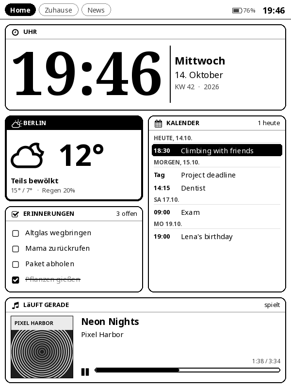

# InkDeck (Deutsch)

**Ein interaktives Home-Dashboard für alte E-Reader.** InkDeck macht aus einem alten Kindle ein Wanddisplay im Stil
eines Home-Assistant- oder iPad-Dashboards – nur eben auf E-Ink. Es läuft als **KOReader-Plugin**, die komplette
Oberfläche wird **auf dem Gerät selbst** gezeichnet, und das Gerät holt sich seine Daten selbst. Kein Server nötig.



Die ausführliche Doku ist auf Englisch: **[README.md](README.md)**. Hier das Wichtigste auf Deutsch.

## Installation

1. **Kindle jailbreaken und KOReader installieren** (bei Kobo entfällt der Jailbreak).
   - Kindle 4: [MobileRead-Wiki](https://wiki.mobileread.com/wiki/Kindle4NTHacking) · alle Modelle: [kindlemodding.org](https://kindlemodding.org)
   - Vorher Flugmodus an, damit sich die Firmware nicht aktualisiert.
   - KOReader-Paket für Kindle 4 / 5 / Paperwhite 1: `kindle`.
2. Den Ordner **`inkdeck.koplugin`** nach **`koreader/plugins/`** auf dem Gerät kopieren.
3. KOReader starten → **Menü → Werkzeuge → InkDeck Dashboard → InkDeck öffnen**.
   Für ein Wanddisplay **„Beim Start von KOReader öffnen“** aktivieren.

Die Oberfläche folgt der Sprache von KOReader. Im Editor kannst du sie unter „Language on the device“ fest auf
Deutsch stellen.

## Bedienung

| Taste | Dashboard | Widget geöffnet |
|---|---|---|
| Steuerkreuz | Auswahl bewegen (am Rand: nächste Seite) | je nach Widget |
| Mitte | Widget groß öffnen | Aktion (abhaken, schalten, Play/Pause …) |
| Blättern | Seite wechseln | nächstes / vorheriges Widget |
| Zurück | zur ersten Seite, Rahmen ausblenden | schließen |
| Menü | InkDeck-Menü (Hoch/Quer, aktualisieren, neu laden, beenden) | InkDeck-Menü |
| Home | InkDeck verlassen | InkDeck verlassen |

## Konfigurieren

`editor/index.html` im Browser öffnen, Seiten und Widgets per Drag & Drop anordnen, **Save config.json** klicken,
die Datei nach `inkdeck/` auf dem Gerät kopieren und dort **Menü → Konfiguration neu laden**.

Wichtige Einstellungen:
- **Zeitzone** auf `Europe/Berlin` stellen – manche Kindles laufen intern auf UTC.
- **Wetter:** Ort im Editor suchen, kein Account nötig.
- **Kalender:** ICS-Link, z. B. Google Kalender → Einstellungen → „Privatadresse im iCal-Format“.
- **Musik ohne Login:** Last.fm-Widget (kostenloser API-Schlüssel) oder Media Player über Home Assistant.

## Optionale Bridge

Nur für direkte Spotify-Steuerung nötig. Läuft auf jedem Rechner im Heimnetz (Mac, Raspberry Pi, Thin Client):

```bash
cd bridge
python3 inkdeck_bridge.py setup     # einmalig Spotify verbinden
sh install-service.sh               # unter Linux als Dienst einrichten (startet automatisch)
```

## Lizenz

MIT – siehe [LICENSE](LICENSE).
