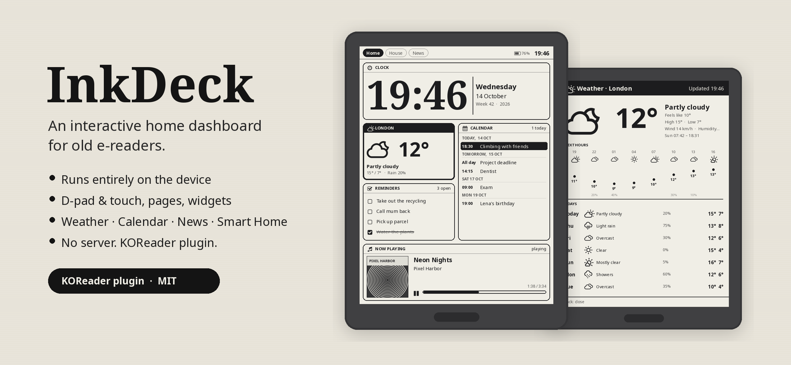
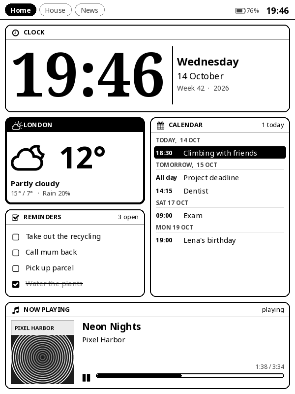
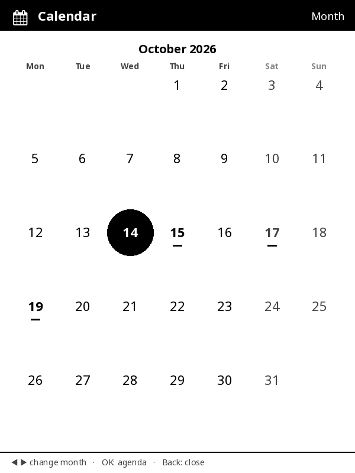
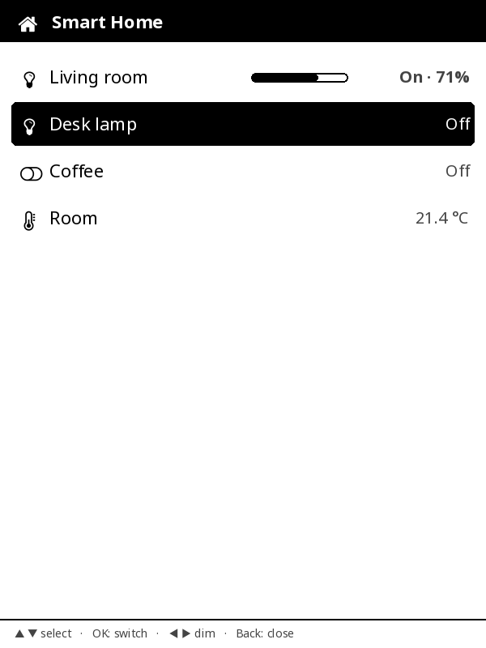
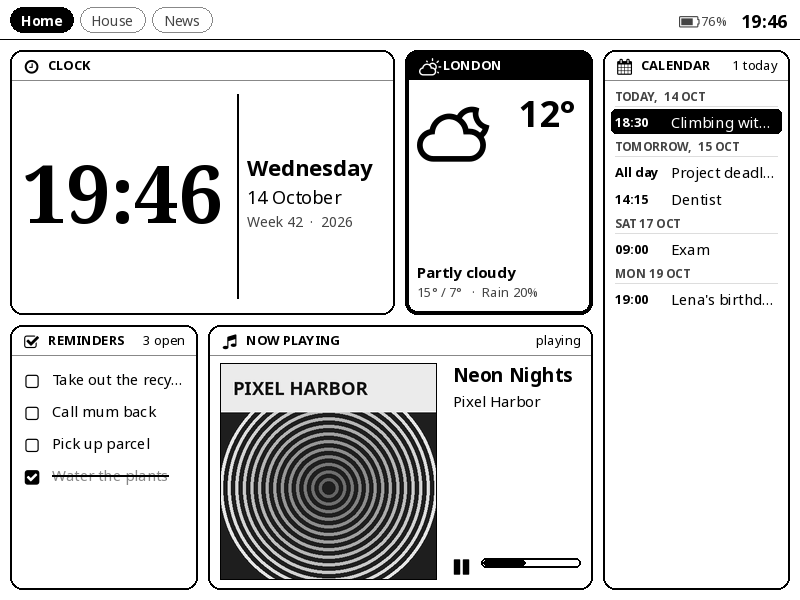

<p align="center">
  
</p>

<p align="center">
  <a href="https://github.com/louiskl/inkdeck/actions/workflows/ci.yml"></a>
  <a href="https://github.com/louiskl/inkdeck/releases/latest"></a>
  
  
  <a href="LICENSE"></a>
</p>

<p align="center">
  <b><a href="#install">Install</a></b> ·
  <b><a href="https://louiskl.github.io/inkdeck/">Open the editor</a></b> ·
  <b><a href="#widgets">Widgets</a></b> ·
  <b><a href="docs/WIDGETS.md">Write a widget</a></b> ·
  <b><a href="README.de.md">Deutsch</a></b>
</p>

---

**InkDeck turns the Kindle in your drawer into a wall display** – in the spirit of a Home Assistant or iPad
dashboard, just on e-ink. It runs as a **KOReader plugin**: the whole UI is drawn **on the device itself**,
and the device fetches its own data. No server, no screenshot service, no cloud account.

<table>
  <tr>
    <td></td>
    <td></td>
    <td></td>
  </tr>
  <tr>
    <td align="center"><sub>Pages of widgets, moved through with the d-pad</sub></td>
    <td align="center"><sub>Open any widget full-screen</sub></td>
    <td align="center"><sub>…and control it right there</sub></td>
  </tr>
</table>

<p align="center"><br>
<sub>Portrait or landscape – the grid adapts. Screenshots are rendered from the real plugin code at 600 × 800 with demo data.</sub></p>

## Why InkDeck?

Most "old Kindle as a dashboard" projects let a server render a PNG that the Kindle just displays.
InkDeck works the other way round:

- **Runs entirely on the e-reader.** Copy one folder into KOReader – done. No Raspberry Pi required.
- **Interactive, not just a picture.** Move a selection with the d-pad, open any widget full-screen and control it
  (switch lights, check off reminders, flip through news, page through your calendar).
- **Made for button Kindles.** The Kindle 4 / Kindle 5 (no touch, page buttons + 5-way pad) are cheap and everywhere –
  InkDeck uses every button. Touch devices work too (tap, swipe).
- **Pages & grid layout** in portrait (2 × 4) or landscape (4 × 2), widgets in four sizes.
- **A drag-and-drop web editor** instead of hand-written config files.
- **E-ink friendly:** only changed tiles are refreshed; periodic full refresh against ghosting; the selection frame hides
  itself when idle.
- **English and German** UI (follows KOReader's language, more languages welcome).

## Widgets

| Widget | Needs | Notes |
|---|---|---|
| **Clock** | – | Big serif digits, date, ISO week; 12/24 h |
| **Weather** | – | [Open-Meteo](https://open-meteo.com), free, no API key; hourly + 7 days |
| **Calendar** | an ICS link | Google / iCloud / Outlook / any `.ics`; recurring events; agenda + month view |
| **News** | RSS / Atom feeds | Headlines, read articles on the device, several sources |
| **Reminders** | – | Stored on the device; check off, delete, add via on-screen keyboard |
| **Now Playing (Last.fm)** | free Last.fm API key | Shows what you play on Spotify, Apple Music, … via scrobbling – no OAuth |
| **Smart Home** | Home Assistant | Lights (toggle + dim), switches, scenes, scripts, sensors |
| **Media Player** | Home Assistant | Any `media_player` (Spotify, Sonos, Chromecast, …): now playing + play/pause/skip/volume |
| **Photo frame** | – | JPG/PNG from a folder, rotates every N minutes |
| **Countdown** | – | Days until / since a date |
| **Note** | – | Static text or a random line from `notes.txt` |
| **Spotify** | optional bridge | Direct Spotify control through the optional InkDeck bridge (see below) |

## Supported devices

InkDeck needs [KOReader](https://koreader.rocks). Primary target: **Kindle 4 (non-touch)**. Any device that runs KOReader
should work: other jailbroken Kindles, Kobo, PocketBook, reMarkable (touch). The layout adapts to the screen size and
is scaled up automatically on high-resolution screens (set `"ui_scale": 1.2` in `config.json` for bigger text).

> **Status: v0.1 – early.** The code is written against KOReader's source and checked with a preview renderer and tests,
> but has not yet been run on lots of real hardware. Bug reports with your device model are very welcome!

## Install

1. **Jailbreak your Kindle and install KOReader** (skip on Kobo – KOReader installs directly).
   - Kindle 4: [MobileRead wiki](https://wiki.mobileread.com/wiki/Kindle4NTHacking) · all models: [kindlemodding.org](https://kindlemodding.org)
   - Turn on airplane mode first so the firmware does not update.
   - KOReader package for Kindle 4 / 5 / Paperwhite 1: `kindle`.
2. **Download** `inkdeck-<version>-plugin.zip` from the [latest release](https://github.com/louiskl/inkdeck/releases/latest),
   unzip it and copy the **`inkdeck.koplugin`** folder into `koreader/plugins/` on the device.
3. Start KOReader → **Menu → Tools (🔧) → InkDeck dashboard → Open InkDeck**.
   Tick **"Open when KOReader starts"** for a wall display.

On first start InkDeck creates an `inkdeck/` folder in the root of the device's USB drive:

```
inkdeck/
├── config.json      ← pages, widgets, settings (make it with the editor)
├── reminders.json   ← your reminders (managed by InkDeck)
├── photos/          ← JPG/PNG for the photo frame
├── notes.txt        ← optional: one quote/note per line
└── calendar.ics     ← optional: a local calendar file
```

## Controls

| Key | Dashboard | Widget opened |
|---|---|---|
| D-pad | move the selection (at the edge: next page) | widget-specific (scroll, select, dim …) |
| OK / center | open widget full-screen | action (check off, toggle, play/pause …) |
| Page keys | switch page | next / previous widget |
| Back | go to the first page, hide the frame | close |
| Menu | InkDeck menu: portrait/landscape, refresh, reload config, exit | same |
| Home | leave InkDeck | leave InkDeck |

Touch: tap a tile to open, swipe left/right for pages, swipe down to close, tap the status bar for the menu.

## Configure with the editor

Open the editor **online at [louiskl.github.io/inkdeck](https://louiskl.github.io/inkdeck/)** – or open
[`editor/index.html`](editor/index.html) locally, it is a single offline file. Nothing you enter is uploaded anywhere:

- add pages, add/remove widgets, pick sizes, **drag & drop** to reorder
- per-widget settings (place search for weather, calendar links, feeds, Home Assistant entities …)
- live preview in portrait and landscape, warning when something doesn't fit
- **Save config.json** → copy to `inkdeck/` on the device → **Menu → Reload configuration**

## The optional bridge

Everything above works without any server. The bridge is only for people who want **direct Spotify control**
(Spotify requires OAuth, which is impractical on an old e-reader). It is a single Python file, standard library only:

```bash
cd bridge
python3 inkdeck_bridge.py setup     # create a Spotify app + log in (instructions in the terminal)
python3 inkdeck_bridge.py           # run it; prints the address to put into the editor
sh install-service.sh               # Linux: run it as a service on boot (Pi, thin client, home server)
```

Spotify currently requires a Premium account for developer apps. Without Premium, use **Last.fm** or the
**Media Player** widget instead.

## Tips for a wall display

- Keep the device on USB power. InkDeck blocks the screensaver while it is open.
- Wi-Fi stays on; InkDeck turns it on at start if needed.
- Resize photos to ~800 px before copying – decoding is faster.
- On Kindles the system time zone is sometimes UTC – set your time zone in the editor.

## Troubleshooting

- A failing widget shows its error inside its tile; the rest keeps running.
- KOReader logs to `koreader/crash.log` – search for `InkDeck`.
- With USBNetwork/SSH: `tail -f /mnt/us/koreader/crash.log`.

## Develop

```
inkdeck.koplugin/
├── main.lua            plugin entry: menu, config, autostart, screensaver, language
└── inkdeck/
    ├── core.lua        pages, layout, focus, full view, menu – no KOReader dependency
    ├── layout.lua      grid packing + d-pad navigation
    ├── view.lua        KOReader widget: keys, touch, timers, partial refresh, rotation
    ├── canvas_ko.lua   drawing API on KOReader's blitbuffer (text, shapes, images)
    ├── ui.lua          shared look: tiles, rows, progress bars
    ├── nowplaying.lua  shared "now playing" layout
    ├── i18n.lua        translations
    ├── util.lua        time zones, dates, ICS + RSS parsers
    ├── net.lua, json.lua
    └── widgets/        one module per widget
editor/                 drag & drop web editor (single HTML file)
bridge/                 optional helper server (Spotify)
tools/                  preview renderer + tests (run on a PC)
docs/WIDGETS.md         how to write a widget
```

**Preview without a device** – runs the real plugin Lua code in LuaJIT and draws with Pillow using KOReader's fonts:

```bash
pip install lupa pillow fonttools
git clone --depth 1 https://github.com/koreader/koreader-fonts
python3 tools/preview.py --fonts koreader-fonts --out previews            # --lang de for German
python3 tools/test_util.py     # time zones, ICS, RSS, JSON, layout, translations
python3 tools/test_glue.py     # KOReader integration against API stubs (keys, touch, rotation, input)
```

Writing your own widget takes ~50 lines – see **[docs/WIDGETS.md](docs/WIDGETS.md)**. Contributions welcome,
see [CONTRIBUTING.md](CONTRIBUTING.md).

## License & credits

MIT – see [LICENSE](LICENSE). Built on [KOReader](https://github.com/koreader/koreader).
Weather data by [Open-Meteo](https://open-meteo.com) (CC BY 4.0). Icons: Nerd Fonts / Weather Icons / Font Awesome as
bundled with KOReader. Not affiliated with Amazon, Spotify, Last.fm or Home Assistant.

<p align="center"><sub>Made with ☕ for the drawer Kindles of this world · <a href="README.de.md">Deutsche Anleitung</a></sub></p>
